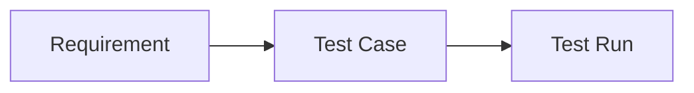
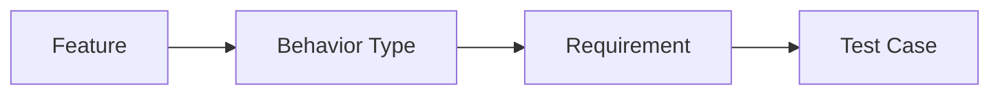

# Codebeamer ASPICE Assessment: подробное описание реализации

## 1. Что было сделано

В проект добавлена полноценная страница assessment для Codebeamer с двумя графическими режимами:

- ASPICE View: lifecycle-граф трассировки Requirement -> Test Case -> Test Run
- Behavior View: граф поведения Feature -> Behavior Type -> Requirement -> Test Case

Также добавлен backend endpoint, который считает метрики, формирует gaps и готовит оба графа для Django UI.

## 2. Какие файлы изменены

### Backend

1) backend/codebeamer_router.py

Добавлено:

- endpoint GET /codebeamer/assessment/test-coverage
- расчет сводных метрик assessment
- расчет process breakdown
- расчет gaps
- формирование graph (ASPICE lifecycle)
- формирование behavior_graph (Feature Behavior)
- формирование behavior_summary и behavior_feature_summary

### Django routing

2) ui/app_main/urls.py

Добавлен route:

- /codebeamer/assessment -> views.codebeamer_assessment

### Django view

3) ui/app_main/views.py

Добавлено:

- view codebeamer_assessment
- вызов backend endpoint /codebeamer/assessment/test-coverage
- подготовка mermaid-строки для ASPICE graph
- подготовка mermaid-строки для Behavior graph
- передача behavior_summary в шаблон

### Django template

4) ui/app_main/templates/app_main/codebeamer_assessment.html

Добавлено:

- новая страница assessment
- фильтры запроса (project_id, freshness_days, include_security)
- карточки summary
- Process Coverage Graph
- переключаемый графический блок ASPICE View / Behavior View
- таблица Test Trackers
- таблица Detected Gaps
- скрипт Mermaid
- скрипт переключения режима графа

### Навигация

5) ui/app_main/templates/app_main/codebeamer.html

Добавлена кнопка перехода:

- ASPICE Assessment

6) ui/app_main/templates/app_main/base.html

Обновлена подсветка активного раздела для codebeamer_assessment и связанных страниц.

## 3. Что делает backend endpoint

Endpoint:

- GET /codebeamer/assessment/test-coverage

Параметры:

- project_id (обязательный)
- freshness_days (по умолчанию 90)
- include_security (по умолчанию true)

Источник данных:

- corpus/{project_id}/codebeamer.json
- item_map, построенный из corpus

### 3.1 Что endpoint вычисляет

1) Summary

- requirements_total
- requirements_with_tests
- requirements_with_runs
- tests_total
- tests_with_runs
- testsets_total
- testconf_total
- runs_total
- runs_passed
- runs_failed
- defects_total
- coverage_ratio
- execution_ratio
- pass_rate
- freshness_ratio
- assessment_score

2) Process breakdown

По зонам:

- SYS.4
- SYS.5
- SWE.4
- SWE.5
- SEC
- UNMAPPED (если не удалось классифицировать)

3) Gaps

- REQ_NO_TESTCASE (error)
- REQ_NO_RUN_EVIDENCE (warning)
- TESTCASE_NO_REQUIREMENT (warning)
- TESTCASE_NO_RUN (warning)
- FAILED_NO_DEFECT (warning)

4) Graph payload

- graph: lifecycle graph для ASPICE View
- behavior_graph: behavior graph для Behavior View
- behavior_summary: агрегат по типам поведения
- behavior_feature_summary: распределение типов по feature-группам

## 4. Логика классификации поведения (Behavior)

В текущей реализации введена эвристика по тексту requirement:

- error: если встречаются признаки ошибки или отказа
- timing: если встречаются признаки времени или performance
- recovery: если встречаются признаки восстановления
- interaction: если встречаются признаки пользовательского взаимодействия
- normal: по умолчанию

Группировка feature делается по имени/ветке трекера (нормализация префикса).

## 5. Что должно происходить по каждому нажатию (подробно)

## 5.1 Кнопка ASPICE Assessment на странице Codebeamer

Где:

- страница /codebeamer

Что происходит:

1) Открывается страница /codebeamer/assessment
2) Берется active project_id из сохраненных credentials
3) Выполняется запрос к backend endpoint assessment
4) Рендерится страница с метриками, графами и gaps

Ожидаемый результат:

- пользователь видит summary
- пользователь видит Process Coverage Graph
- пользователь видит граф (в зависимости от выбранного режима)

## 5.2 Кнопка Recalculate на assessment-странице

Где:

- форма фильтров вверху /codebeamer/assessment

Что происходит:

1) Форма отправляет GET с параметрами:
   - project_id
   - freshness_days
   - include_security
2) Django view повторно вызывает backend endpoint
3) Страница обновляется с новыми расчетами

Ожидаемый результат:

- summary и gaps пересчитываются
- process breakdown пересчитывается
- графы строятся по новым данным

## 5.3 Переключатель ASPICE View

Где:

- панель Graph mode

Что происходит при нажатии:

1) Активируется кнопка ASPICE View
2) Показывается pane-aspice
3) Скрывается pane-behavior

Что видно пользователю:

- граф Requirement -> Test Case -> Test Run

## 5.4 Переключатель Behavior View

Где:

- панель Graph mode

Что происходит при нажатии:

1) Активируется кнопка Behavior View
2) Показывается pane-behavior
3) Скрывается pane-aspice

Что видно пользователю:

- граф Feature -> Behavior Type -> Requirement -> Test Case

## 5.5 Checkbox Include security test lane

Где:

- в фильтрах рядом с freshness_days

Что происходит:

1) Если включен, в расчеты включаются security-тестовые трекеры
2) Если выключен, security lane исключается из test case выборки
3) Требуется нажатие Recalculate

Что видно пользователю:

- изменятся counts, gaps, process breakdown и графы

## 5.6 Кнопка Back to Codebeamer

Что происходит:

- возврат на /codebeamer

## 5.7 Кнопка Tree

Что происходит:

- переход на /codebeamer/tree

## 6. Mermaid: как используется в реализации

## 6.1 Что такое Mermaid в этой странице

Mermaid используется для рендера текстового graph definition в визуальный граф.

Источник:

- ASPICE graph: формируется в Django из payload graph
- Behavior graph: формируется в Django из payload behavior_graph

В шаблоне оба графа рендерятся через:

- <pre class="mermaid"> ... </pre>

и загрузчик:

- import mermaid from CDN
- mermaid.initialize(...)

## 6.2 Почему раньше переключатель мог не работать

Ранее обработчики переключения находились в модульном скрипте вместе с импортом Mermaid.
Если CDN недоступен, модуль мог не выполниться и обработчики не вешались.

Исправление:

- логика переключения вынесена в отдельный обычный script
- теперь переключение pane работает независимо от загрузки Mermaid

Важно:

- если Mermaid не загрузится, переключение панелей все равно работает
- но граф может остаться как текст или не отрисоваться (в зависимости от браузера)

## 6.3 Минимальные ожидаемые сценарии для Mermaid

1) Mermaid доступен:

- оба режима показывают отрисованные графы

2) Mermaid недоступен:

- переключение ASPICE/Behavior работает
- графы могут не визуализироваться (fallback: пользователь видит блок, но без схемы)

## 7. Схемы (Mermaid) для понимания режимов

### 7.1 ASPICE View

### 7.2 Behavior View

## 8. Как проверить, что все работает правильно

## 8.1 Backend

Проверить endpoint:

- GET /codebeamer/assessment/test-coverage?project_id=10&freshness_days=90&include_security=true

Ожидание:

- ok=true
- присутствует graph
- присутствует behavior_graph
- присутствует behavior_summary

## 8.2 Frontend

Открыть:

- /codebeamer/assessment

Проверить:

1) Виден summary
2) Кнопка ASPICE View переключает на lifecycle-граф
3) Кнопка Behavior View переключает на behavior-граф
4) Кнопки визуально меняют active state
5) Recalculate пересчитывает данные при изменении фильтров

## 9. Что считается корректным поведением UI

1) По умолчанию открыт ASPICE View
2) При нажатии Behavior View граф меняется на другую структуру
3) При обратном нажатии ASPICE View возвращается lifecycle-граф
4) Переключение работает мгновенно (клиентская логика, без запроса к серверу)
5) Запрос к серверу выполняется только при Recalculate

## 10. Ограничения текущей версии

1) Behavior классификация эвристическая, не доменная онтология
2) Feature-группировка основана на именах трекеров/префиксах
3) Mermaid зависит от внешнего CDN
4) Большие графы ограничиваются по числу узлов/ребер для производительности

## 11. Рекомендации следующего шага

1) Добавить локальный fallback для Mermaid (self-hosted JS)
2) Вынести классификацию behavior в отдельный rule-profile
3) Добавить легенду по типам узлов в графах
4) Добавить фильтр по feature в Behavior View
5) Добавить экспорт графа и gaps в JSON/CSV

## 12. Кратко: что пользователь должен увидеть

После открытия assessment-страницы пользователь должен иметь:

- понятную сводку ASPICE test assessment
- процессные метрики по SYS/SWE
- два графических режима (ASPICE и Behavior)
- список gaps с severity и message
- предсказуемое поведение при каждом нажатии кнопок
